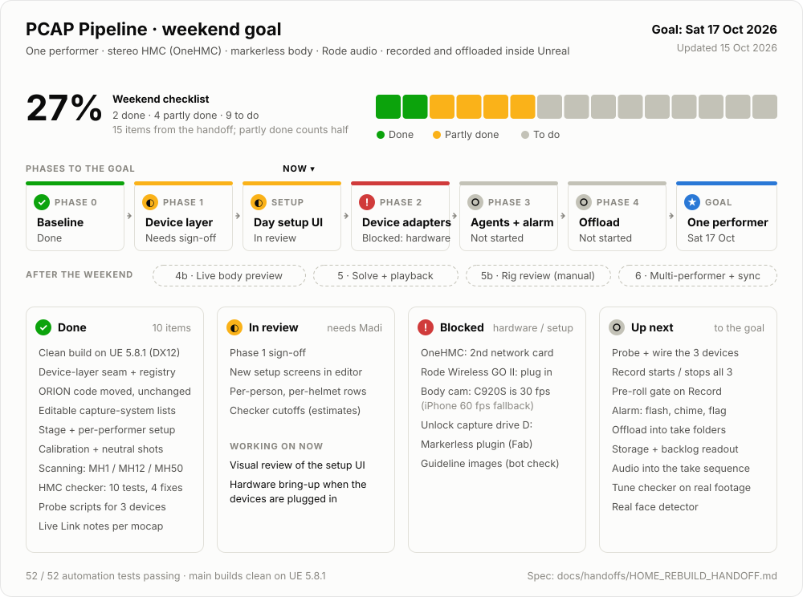
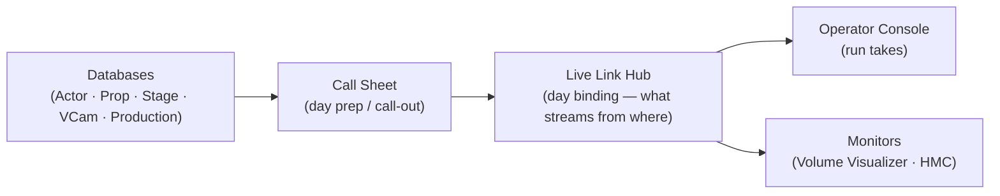

# PCAP Pipeline

## Where we are

  

**Goal:** one performer, stereo HMC, fully working by **Saturday 17 Oct 2026**: OneHMC facial, markerless body and Rode audio, recorded and offloaded from inside Unreal, with a floor alarm. Spec: [Home rebuild handoff](docs/handoffs/HOME_REBUILD_HANDOFF.md).

**Working on now:** reviewing the new setup screens in the editor, then bringing up the three devices as they are plugged in ([bring-up checklist](docs/devices/BRINGUP.md)).

<b>Weekend checklist, item by item</b> (2 done · 4 partly · 9 to do)

| | Item (handoff §10) | Where it stands |
|---|---|---|
| ✅ | Clean build on UE 5.8, DX12 | Builds clean on 5.8.1; DX12 confirmed at boot |
| ✅ | Technoprops/ORION behavior unchanged | Code moved behind the device interface, URL strings pinned by tests |
| 🟡 | Capture Setup row per performer | Facial, mono/stereo, helmet, mocap, audio; separate "save as default". Facial preset, camera and input picks still to add |
| 🟡 | Fact sheet + PASS log per device | Fact sheets written; PASS logs need the hardware |
| 🟡 | Agents judge feeds with Epic-sourced thresholds | HMC checker tested and 4 bugs fixed; thresholds still need tuning on real footage; no body checks yet |
| 🟡 | Docs updated | This page, device sheets, handoff status |
| ⬜ | Guideline images fetched locally | Epic's site blocks the fetch script; fetch in a browser |
| ⬜ | Record starts and stops all three devices, offsets logged | Phase 2 |
| ⬜ | Pre-roll gate blocks Record with a reason | Phase 3 |
| ⬜ | Red alarm: flash, chime, take auto-flagged | Phase 3 |
| ⬜ | OneHMC firmware / mono-stereo mismatch blocks Record | Phase 2, needs the unit on 0.2.0 |
| ⬜ | Body camera mode from measured modes | C920S tops out at 30 fps (Epic wants 60); iPhone is the fallback |
| ⬜ | Storage readout: free space, minutes left, backlog | Phase 4, after D: is unlocked |
| ⬜ | Offload into take folders with `take.json` | Phase 4 |
| ⬜ | Audio in the take's Level Sequence | Phase 2 (Rode Wireless GO II) |

<b>Phases</b>

| Phase | Status | Next step |
|---|---|---|
| 0 · Baseline | ✅ Done | Open: guideline images, Markerless plugin (Fab), unlock D:, Vicon plugin off (DLL missing) |
| 1 · Device layer | 🟡 Built, awaiting sign-off | Madi's sign-off |
| Setup UI | 🟡 In review | Capture systems, stage dropdowns, Capture Setup, Scanning (MH1/MH12/MH50), calibration + neutral-face shots, actor call sheet |
| 2 · Device adapters | 🔴 Blocked on hardware | OneHMC (own network, second network card), Rode GO II, body camera |
| 3 · Agents + alarm | ⬜ Not started | After Phase 2 |
| 4 · Offload | ⬜ Not started | After Phase 2 and OneHMC file sizes |
| 4b · Live body preview | ⬜ Stretch | Cut first if short on time |
| 5 / 5b / 6 | After the weekend | Solve + playback, rig review (manual), multi-performer + sync |

Automation tests: **52 / 52 passing**. The image is [`docs/assets/status-overview.svg`](docs/assets/status-overview.svg); update it with this section.
---

A performance-capture session-management pipeline for **Unreal Engine 5.8**, built for a solo operator (or small team) running a mocap volume end to end: **prep the day → run the takes → watch the floor.**

The heart of the project is the **PCAPTool** editor plugin — a workflow-organized toolset on top of one shared data model — plus **LiveLinkViconDataStream** for getting Vicon data into the engine. On 5.8, PCAPTool's data model drives Epic's official **Performance Capture** plugins (the **Mocap Manager**): the databases are the source of truth and a bridge spawns/configures the engine's `ACapturePerformer` actors (Performance Capture **Core**) and `UPCapPropComponent` props (Performance Capture **Workflow**) from the called shot.

---

## The toolset

Tools register under **Window ▸ Tools** in two groups — **PCAP Tools** (operator tools) and **Databases** (the libraries).

| Tool | Group | What it does |
|---|---|---|
| **Call Sheet** | PCAP Tools | Single-page day prep — pick production / day / stage, call out actors · props · vcam, build the shot list (CSV import/export) |
| **Operator Console** | PCAP Tools | Navigate the day's shots and run takes (Take Recorder backend) |
| **HMC Monitor** | PCAP Tools | Per-camera head-mounted-camera health checks |
| **VCam Operator** | PCAP Tools | Virtual camera control (a WVCAM replacement) |
| **Actor / Prop / Stage / VCam / Production Database** | Databases | Permanent card libraries — everything ever created |
| **Volume Visualizer** | *placeable actor* | Vicon markers as dots + labels, to scale inside the stage FBX |

## Architecture — the spine

Libraries hold the data, the Call Sheet preps the day from them, Live Link binds the called-out items to their live sources at runtime, and purpose-built monitors watch the floor.

**Principles:** databases are pure libraries (no Live Link) that expose shared Slate widgets; the Call Sheet *composes* those widgets rather than re-implementing them; monitoring is distributed into small purpose-built surfaces, not one mega-panel. All tool assets live under one content root, `/Game/PCAPTool/` (see `PCAPToolPaths.h`).

## Plugins

| Plugin | Purpose |
|---|---|
| [`PCAPTool`](Plugins/PCAPTool) | The toolset + data model. Editor module; drops into any UE5 project. |
| `LiveLinkViconDataStream` | Vicon DataStream → Live Link, and the bundled Vicon DataStream SDK that the Volume Visualizer uses for the raw marker cloud. |
| `Performance Capture` *(engine)* | Epic's official Mocap Manager. PCAPTool builds on its data model — `UPCAPMocapBridge` maps called actors onto `ACapturePerformer` (Core) and props onto `UPCapPropComponent` (Workflow, under `Engine/Plugins/VirtualProduction/`). |

## Build & run

- **Engine:** Unreal Engine **5.8**. The project builds on **Windows** (MSVC). Enable the **Performance Capture Core** and **Performance Capture Workflow** plugins (both ship with the engine — Core under `Engine/Plugins/Animation/`, Workflow under `Engine/Plugins/VirtualProduction/`). PCAPTool depends on their `PerformanceCaptureCore` / `PerformanceCaptureWorkflowRuntime` modules. To build against Core alone, set `WITH_PCAP_WORKFLOW=0` in `PCAPTool.Build.cs`.
- Right-click `PCAPPipeline.uproject` → **Generate Visual Studio project files**, then build **Development Editor / Win64** (or open the `.uproject` and let it compile the modules).
- After a successful build, **restart the editor** — the tool tabs register at module startup — and find them under **Window ▸ Tools**.

## Repository layout

| Path | What |
|---|---|
| `PCAPPipeline.uproject` | The UE project |
| `Source/` | Project-level game module |
| `Plugins/PCAPTool/` | The PCAP toolset plugin ([README](Plugins/PCAPTool/README.md)) |
| `Plugins/LiveLinkViconDataStream/` | Vicon DataStream Live Link + SDK |
| `Config/` | Project config (`.ini`) |
| `Content/` | UE content (assets live under `Content/PCAPTool/`) |
| `docs/` | Design specs, plans, per-tool how-tos ([index](docs/README.md)) |
| `CONTRIBUTING.md` | Build steps + git workflow + repo conventions |

## Documentation

Design specs, implementation plans, and per-tool how-tos live in [`docs/`](docs/README.md) — start at the index. Each substantial feature is brainstormed into a dated `*-design.md` spec before it's built. See [CONTRIBUTING](CONTRIBUTING.md) for how the repo is worked: build steps, the Mac-authors / Windows-builds split, and the git guardrails.

## License

**To be determined.** No open-source license has been chosen yet, so the code is currently all-rights-reserved by default. Bundled third-party components keep their own terms — notably **Unreal Engine** (governed by the [Unreal Engine EULA](https://www.unrealengine.com/eula)) and the **Vicon DataStream SDK** (Vicon's own license). If this repository is or becomes public, the vendored Vicon SDK binary and Vicon sample content should be reviewed against Vicon's redistribution terms before relying on any project-wide license.
