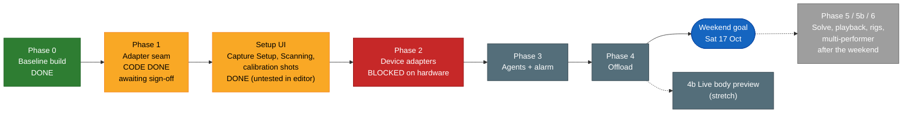
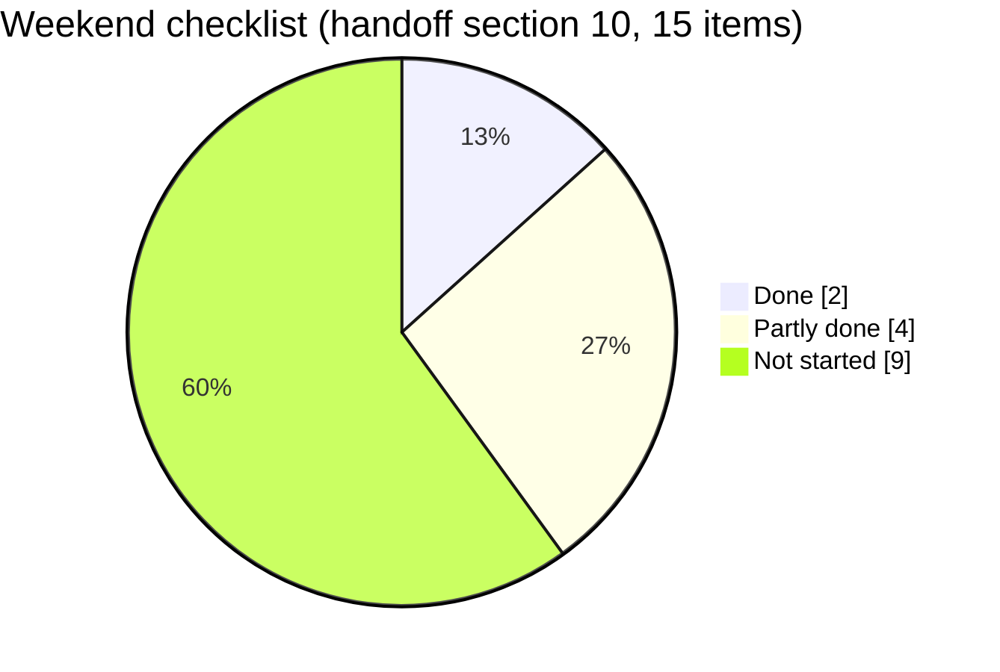
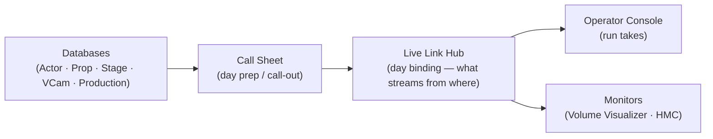

# PCAP Pipeline

## Where we are (updated 2026-10-15)

**Goal:** one performer, stereo HMC, fully working, **Saturday 2026-10-17**: OneHMC facial, markerless body, Rode audio, recorded and offloaded from inside Unreal, with a floor alarm. Spec: [Home rebuild handoff](docs/handoffs/HOME_REBUILD_HANDOFF.md).

**Distance to goal:** the build, the device-layer seam, and the day-setup screens are done. What's left for Saturday is everything that touches the hardware: wiring the OneHMC, body camera and Rode (Phase 2, waiting on the devices being plugged in and probed), the alarms (Phase 3) and offload (Phase 4). Facial and body solves run after the weekend (Phase 5).

| Phase | Status | Done | Blocking / next |
|---|---|---|---|
| 0 · Baseline | Done | Clean build on UE 5.8.1 (fixed a compile error), DX12 confirmed, Capture Manager Editor on, FFmpeg encoder set | Guideline images (Epic's site blocks the script), Markerless plugin from Fab, unlock capture drive D:, Vicon plugin disabled (DLL missing) |
| 1 · Adapter seam | Code done, awaiting sign-off | Device interfaces + registry, ORION transport moved unchanged, old HMC component retired, data model added | Madi's sign-off |
| Setup UI | Done, not yet seen in the editor | Editable capture-system lists, Stage Database dropdowns, per-performer per-helmet Capture Setup, calibration shots (audio / facial start + end / body / neutral face per actor per day), Scanning with Epic's MH1/MH12/MH50 poses, actor call sheet, Live Link notes per mocap system | Visual review |
| HMC checker | Tested on generated frames | 10 tests; fixed 4 real bugs (underexposed never fired, lit wall read as a face, any face passed the board check, fps target 30 instead of Epic's 60) | Focus threshold and the rest need tuning on real OneHMC footage; real face detector to come |
| 2 · Device adapters | Blocked | Fact sheets + probe scripts ready ([devices](docs/devices/)) | Plug in and probe: OneHMC (own network), Rode Wireless GO II, body camera (Logitech C920S is 30 fps max, under Epic's 60; iPhone is the fallback) |
| 3 · Agents + alarm | Not started | | Phase 2 |
| 4 · Offload | Not started | | Phase 2 + OneHMC file sizes |
| 5–6 | After the weekend | | |

Automation tests: **52 / 52 passing** (`UnrealEditor-Cmd ... -ExecCmds="Automation RunTests PCAP"`).

---

A performance-capture session-management pipeline for **Unreal Engine 5.8**, built for a solo operator (or small team) running a mocap volume end to end: **prep the day → run the takes → watch the floor.**

The heart of the project is the **PCAPTool** editor plugin — a workflow-organized toolset on top of one shared data model — plus **LiveLinkViconDataStream** for getting Vicon data into the engine. On 5.8, PCAPTool's data model drives Epic's official **Performance Capture** plugins (the **Mocap Manager**): the databases are the source of truth and a bridge spawns/configures the engine's `ACapturePerformer` actors (Performance Capture **Core**) and `UPCapPropComponent` props (Performance Capture **Workflow**) from the called shot.

---

## The toolset

Tools register under **Window ▸ Tools** in two groups — **PCAP Tools** (operator tools) and **Databases** (the libraries).

| Tool | Group | What it does |
|---|---|---|
| **Call Sheet** | PCAP Tools | Single-page day prep — pick production / day / stage, call out actors · props · vcam, build the shot list (CSV import/export) |
| **Operator Console** | PCAP Tools | Navigate the day's shots and run takes (Take Recorder backend) |
| **HMC Monitor** | PCAP Tools | Per-camera head-mounted-camera health checks |
| **VCam Operator** | PCAP Tools | Virtual camera control (a WVCAM replacement) |
| **Actor / Prop / Stage / VCam / Production Database** | Databases | Permanent card libraries — everything ever created |
| **Volume Visualizer** | *placeable actor* | Vicon markers as dots + labels, to scale inside the stage FBX |

## Architecture — the spine

Libraries hold the data, the Call Sheet preps the day from them, Live Link binds the called-out items to their live sources at runtime, and purpose-built monitors watch the floor.

**Principles:** databases are pure libraries (no Live Link) that expose shared Slate widgets; the Call Sheet *composes* those widgets rather than re-implementing them; monitoring is distributed into small purpose-built surfaces, not one mega-panel. All tool assets live under one content root, `/Game/PCAPTool/` (see `PCAPToolPaths.h`).

## Plugins

| Plugin | Purpose |
|---|---|
| [`PCAPTool`](Plugins/PCAPTool) | The toolset + data model. Editor module; drops into any UE5 project. |
| `LiveLinkViconDataStream` | Vicon DataStream → Live Link, and the bundled Vicon DataStream SDK that the Volume Visualizer uses for the raw marker cloud. |
| `Performance Capture` *(engine)* | Epic's official Mocap Manager. PCAPTool builds on its data model — `UPCAPMocapBridge` maps called actors onto `ACapturePerformer` (Core) and props onto `UPCapPropComponent` (Workflow, under `Engine/Plugins/VirtualProduction/`). |

## Build & run

- **Engine:** Unreal Engine **5.8**. The project builds on **Windows** (MSVC). Enable the **Performance Capture Core** and **Performance Capture Workflow** plugins (both ship with the engine — Core under `Engine/Plugins/Animation/`, Workflow under `Engine/Plugins/VirtualProduction/`). PCAPTool depends on their `PerformanceCaptureCore` / `PerformanceCaptureWorkflowRuntime` modules. To build against Core alone, set `WITH_PCAP_WORKFLOW=0` in `PCAPTool.Build.cs`.
- Right-click `PCAPPipeline.uproject` → **Generate Visual Studio project files**, then build **Development Editor / Win64** (or open the `.uproject` and let it compile the modules).
- After a successful build, **restart the editor** — the tool tabs register at module startup — and find them under **Window ▸ Tools**.

## Repository layout

| Path | What |
|---|---|
| `PCAPPipeline.uproject` | The UE project |
| `Source/` | Project-level game module |
| `Plugins/PCAPTool/` | The PCAP toolset plugin ([README](Plugins/PCAPTool/README.md)) |
| `Plugins/LiveLinkViconDataStream/` | Vicon DataStream Live Link + SDK |
| `Config/` | Project config (`.ini`) |
| `Content/` | UE content (assets live under `Content/PCAPTool/`) |
| `docs/` | Design specs, plans, per-tool how-tos ([index](docs/README.md)) |
| `CONTRIBUTING.md` | Build steps + git workflow + repo conventions |

## Documentation

Design specs, implementation plans, and per-tool how-tos live in [`docs/`](docs/README.md) — start at the index. Each substantial feature is brainstormed into a dated `*-design.md` spec before it's built. See [CONTRIBUTING](CONTRIBUTING.md) for how the repo is worked: build steps, the Mac-authors / Windows-builds split, and the git guardrails.

## License

**To be determined.** No open-source license has been chosen yet, so the code is currently all-rights-reserved by default. Bundled third-party components keep their own terms — notably **Unreal Engine** (governed by the [Unreal Engine EULA](https://www.unrealengine.com/eula)) and the **Vicon DataStream SDK** (Vicon's own license). If this repository is or becomes public, the vendored Vicon SDK binary and Vicon sample content should be reviewed against Vicon's redistribution terms before relying on any project-wide license.
